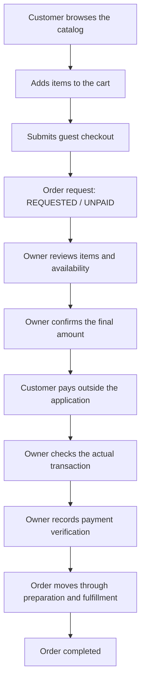
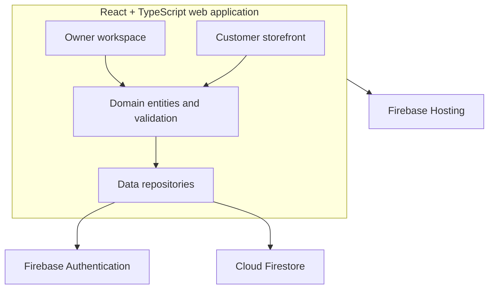

<!--
  KudapKita — repository overview
  Keep this document aligned with the default branch (main).
-->

<div align="center">

  

  <h1>KudapKita</h1>

  <p><strong>Jajan Enak, Dekat, dan Praktis.</strong></p>
  <p>A considered digital storefront for everyday Indonesian snacks — bringing product discovery, order requests, and owner operations into one coherent experience.</p>

  <p>
    
    
    
    
    
    
  </p>

  <p>
    <a href="#project-overview">Overview</a> ·
    <a href="#product-experience">Experience</a> ·
    <a href="#architecture">Architecture</a> ·
    <a href="#getting-started">Get started</a> ·
    <a href="#project-documentation">Documentation</a>
  </p>

</div>

---

## Project overview

KudapKita is a web application for a family-run snack business. It brings the customer-facing storefront and the owner's working area into one maintainable codebase, with each experience shaped around a different purpose.

For customers, the journey is intentionally straightforward: discover products, build a cart, submit an order request, and continue the confirmation process with the store. For the owner, the application provides a private place to review incoming requests, confirm the final amount, reconcile payments manually, and update order progress.

The product is designed around real operating practices rather than an artificial instant-checkout flow. Availability, final pricing, fulfillment arrangements, and payment are confirmed by the owner before an order proceeds.

> **Development status**  
> The default `main` branch contains the current MVP foundation. It is not yet a production release. Several owner modules remain placeholders, and the repository has outstanding integration and quality-gate work. This README describes `main` unless a section explicitly identifies the separate development branch.

## Brand and experience direction

The visual direction is **Warm Modern Artisanal**: contemporary digital craft with the warmth and familiarity of a neighborhood snack business.

| Design element | Direction | Role in the experience |
| --- | --- | --- |
| Cocoa | `#493127` | Brand presence, strong headings, and primary surfaces |
| Cream | `#F8F4EC` | Warm, quiet backgrounds and breathing room |
| Terracotta | `#B85D2E` | Calls to action and selected accents |
| Sage | `#54745B` | Calm supporting accents and availability cues |
| Typography | Serif display + clean sans-serif | A balance of character and readability |

The storefront prioritizes product discovery, clear information, and an approachable tone. The owner workspace prioritizes task clarity and operational status. Motion is used selectively, and the global stylesheet includes a reduced-motion preference.

The design handoff and HTML prototype are references for visual direction, not proof that every prototype interaction has been implemented in the application.

## Product experience

### Customer storefront

| Capability | Current implementation |
| --- | --- |
| Home page | Brand introduction, primary navigation, and featured catalog items |
| Product catalog | Published Firestore products, keyword search, and category filtering |
| Product cards | Product name, category, description, price display, availability, and add-to-cart action |
| Cart | Quantity adjustment, item removal, and browser-local persistence |
| Guest checkout | Customer name, WhatsApp number, pickup/delivery choice, address, and optional note |
| Order request | Creates an initial Firestore request using Firebase Anonymous Authentication |
| WhatsApp handoff | Opens a prepared message with the order reference when a public number is configured |
| Order tracking | Displays order and payment status to the guest session that created the request |

### Owner workspace

| Capability | Current implementation |
| --- | --- |
| Owner sign-in | Firebase Email/Password authentication |
| Access control | Active owner profile check using `userProfiles/{uid}` |
| Dashboard | Basic recent-order summary and request counts |
| Order inbox | Review order details, set a confirmed total, verify a payment manually, and update order progress |
| Product management | Placeholder page; CRUD is not active on `main` |
| Categories, production, inventory, direct sales, reports, and settings | Placeholder pages on `main` |

### Order lifecycle

A checkout submission is an **order request**, not an automatically accepted order or a payment.



The order status and payment status are separate fields. A WhatsApp message, transfer screenshot sent outside the app, or customer notification does not automatically establish that a payment has been received.

## Current scope and release boundaries

The following matrix distinguishes implemented behavior from planned functionality. It is intentionally explicit so that the README remains a reliable technical reference.

| Area | Status on `main` | Notes |
| --- | --- | --- |
| Responsive storefront shell | Available | Home, catalog, cart, checkout, and tracking routes |
| Firestore-backed public catalog | Available when configured | Reads published product documents |
| Search and category filter | Available | No advanced sort or catalog CMS |
| Cart persistence | Available | Stored in the current browser |
| Guest order request | Available when Firebase is configured | Initial state is `REQUESTED` and `UNPAID` |
| WhatsApp follow-up | Available when configured | Communication handoff, not in-app payment |
| Owner login and order inbox | Available when configured | Owner profile must be provisioned |
| Product detail page | Not implemented | Product-card query parameter is not consumed by the catalog page |
| Product and category CRUD | Not implemented | Owner pages are placeholders |
| Production and finished-goods inventory | Not implemented | Owner pages are placeholders |
| Direct sales and operational reports | Not implemented | Owner pages are placeholders |
| Product photography | Pending | Product cards currently show a visual placeholder |
| Dynamic campaign carousel | Not implemented | Home hero is static |
| Firebase Storage upload | Not configured | No in-app product or payment-proof upload |
| Payment gateway or webhook | Not implemented | Payment reconciliation is manual |
| Automatic delivery pricing and route calculation | Not implemented | Delivery details are submitted for owner confirmation |
| Customer accounts and cross-device order history | Not implemented | Guest tracking depends on the original browser session |
| Offline transactions | Not supported | Service worker caches only the static application shell |

### Demo catalog

When Firebase is not configured, `VITE_ENABLE_DEMO_CATALOG=true` can display clearly marked fixture products from `apps/web/src/data/fixtures/demo-products.ts`. These records are for interface development only; they are not the authoritative KudapKita menu, approved pricing, or live stock.

With Firebase configured, the storefront reads published records from `publicProducts`. Real product names, descriptions, prices, availability, and approved photography should be maintained from verified business information.

## Architecture

KudapKita uses a **single web application with separated application areas**. React Router organizes the storefront and owner routes, domain modules hold the application entities and validation rules, and repositories isolate Firestore access.



### Data and trust boundaries on `main`

- `publicProducts` and `publicCategories` are intended for customer-facing catalog data.
- `products`, `categories`, `payments`, `inventory`, `stockMovements`, `directSales`, and private settings are owner-only data areas in the Firestore Rules model.
- Guest checkout uses Firebase Anonymous Authentication. A customer can create an initial request and read their own order while the original guest session remains available.
- Owner access requires a matching active profile document. The browser does not provide a public owner-registration flow.
- React route guards improve navigation and user experience; Firestore Security Rules remain the data authorization boundary.

**Important MVP limitation:** on `main`, order creation and owner order/payment updates are performed from the web client through the Firebase Web SDK. There is no trusted callable Cloud Functions backend on this branch. Owner-only Rules restrict who can perform those writes, but they do not provide the stronger server-controlled transaction boundary required for robust concurrent stock operations, trusted price calculation, or payment automation.

## Technology

| Layer | Technology | Responsibility |
| --- | --- | --- |
| UI | React 19 | Component-based customer and owner experiences |
| Language | TypeScript 5.9 | Application types and static checking |
| Build tooling | Vite 7 | Development server and production build |
| Styling | Tailwind CSS 4 + project CSS tokens | Responsive interface and visual system |
| Routing | React Router 7 | Storefront and protected owner routes |
| Authentication | Firebase Authentication | Anonymous customer sessions and owner sign-in |
| Database | Cloud Firestore | Catalog, order requests, and operational records |
| Icons | Lucide React | Interface iconography |
| Hosting | Firebase Hosting configuration | Static SPA deployment |
| PWA foundation | Web App Manifest + Service Worker | Install metadata and static app-shell caching |

The service worker is registered in production and caches a small set of shell assets. Firestore and authentication data are not cached as offline transactions.

## Getting started

### Prerequisites

- Node.js **24.12.0 or newer**, as required by the root `package.json`
- npm
- A Firebase project for real catalog, checkout, and owner workflows

> **Runtime alignment note:** the current `.nvmrc` and GitHub Actions workflow still specify Node.js 22, while `package.json` requires Node.js 24.12.0 or newer. Use a compatible Node.js version for local development and align these configuration files before relying on CI.

### 1. Clone the repository

```bash
git clone https://github.com/gusti111/KudapKita.git
cd KudapKita
```

### 2. Install dependencies

```bash
npm ci
```

### 3. Create the local environment file

**Windows PowerShell**

```powershell
Copy-Item .env.example .env.local
```

**macOS / Linux**

```bash
cp .env.example .env.local
```

### 4. Configure environment variables

Add the Firebase Web App values from **Firebase Console → Project settings → Your apps**.

| Variable | Purpose |
| --- | --- |
| `VITE_FIREBASE_API_KEY` | Firebase Web App API key |
| `VITE_FIREBASE_AUTH_DOMAIN` | Firebase Authentication domain |
| `VITE_FIREBASE_PROJECT_ID` | Firebase project ID |
| `VITE_FIREBASE_MESSAGING_SENDER_ID` | Firebase messaging sender ID |
| `VITE_FIREBASE_APP_ID` | Firebase Web App ID |
| `VITE_PUBLIC_WHATSAPP_NUMBER` | Public WhatsApp number in international digits-only format |
| `VITE_ENABLE_DEMO_CATALOG` | Enables demo catalog fixtures when Firebase is not configured |

The Firebase Web configuration identifies the browser application; it is not a substitute for server credentials. Never place service-account JSON, private keys, passwords, payment credentials, or privileged tokens in a `VITE_*` variable.

### 5. Start the development server

```bash
npm run dev
```

Vite is configured to listen on port `5173` and host `0.0.0.0`. Open the local address shown in the terminal, normally:

```
http://localhost:5173
```

### 6. Run the available quality checks

```bash
npm run typecheck
npm run build
npm run preview
```

The production build is written to `dist/`. The current `main` branch does not contain the `functions/` directory, even though two root scripts still reference it. The `check:functions` and `test:functions` scripts are therefore not usable on `main` until the backend branch is reconciled.

## Firebase project setup

For real customer and owner flows, configure the Firebase project before testing:

1. Create or select the Firebase project that belongs to the business.
2. Register a Firebase Web App and copy its configuration into `.env.local`.
3. Enable **Anonymous** sign-in for guest checkout.
4. Enable **Email/Password** sign-in for the owner.
5. Create the Cloud Firestore database.
6. Review and deploy the repository's Firestore rules and indexes.
7. Create the owner account in Firebase Authentication.
8. Provision the matching owner profile in `userProfiles/{uid}` through a trusted administrative process.

The required owner profile shape is:

```json
{
  "uid": "FIREBASE_AUTH_UID",
  "displayName": "KudapKita Owner",
  "email": "OWNER_EMAIL",
  "role": "owner",
  "isActive": true
}
```

Do not create owner privileges from the public browser. Do not share owner credentials or commit local environment files.

### Deploy Firestore rules and indexes

Install and authenticate the Firebase CLI, then deploy to the intended project:

```bash
firebase login
firebase deploy --project YOUR_FIREBASE_PROJECT_ID --only firestore:rules,firestore:indexes
```

Replace `YOUR_FIREBASE_PROJECT_ID` with the verified project ID. Test access for signed-out visitors, anonymous customers, non-owner accounts, active owners, and inactive owners before using real customer data.

## Deployment

The current `firebase.json` configures **Firebase Hosting** and **Cloud Firestore rules/indexes**. It does not configure Cloud Functions, Firebase Storage, or Emulator Suite services on `main`.

Build the application:

```bash
npm run build
```

Deploy the static site:

```bash
firebase deploy --project YOUR_FIREBASE_PROJECT_ID --only hosting
```

The Hosting configuration serves the `dist/` directory and rewrites application routes to `index.html` for client-side routing.

A successful Hosting deployment does not mean the application is production-ready. Before launch, validate the Firebase project, owner provisioning, Firestore rules, actual catalog content, product images, contact information, payment instructions, fulfillment arrangements, mobile behavior, and recovery process.

## Repository structure

```text
KudapKita/
├── apps/
│   └── web/
│       ├── public/
│       │   ├── brand/                 # Brand mark and application icons
│       │   ├── images/products/       # Approved product photography (to be added)
│       │   ├── manifest.webmanifest
│       │   └── sw.js                  # Static app-shell cache
│       └── src/
│           ├── app/                   # App composition, providers, routes, guards
│           ├── areas/
│           │   ├── storefront/        # Home, catalog, cart, checkout, tracking
│           │   └── owner/             # Login, dashboard, orders, owner modules
│           ├── data/                  # Fixtures and Firestore repositories
│           ├── domain/                # Entities, statuses, validation rules
│           ├── infrastructure/        # Firebase client initialization
│           ├── shared/                # UI primitives, styles, constants, utilities
│           └── main.tsx               # React entry point
├── firebase/
│   ├── firestore.rules
│   └── firestore.indexes.json
├── docs/                              # Product, design, architecture, and security docs
├── .env.example
├── firebase.json
├── package.json
├── package-lock.json
├── tsconfig*.json
└── vite.config.ts
```

## Project documentation

The repository includes product decisions and technical references. These documents complement the code; where a document describes future scope, it should not be read as evidence that the feature is already implemented.

| Document | Purpose |
| --- | --- |
| [Product Requirements Document](docs/requirements/PRD_KudapKita_WebApp_MobileWeb_v1.0.pdf) | Product scope, user needs, and requirements |
| [Design Brief](docs/requirements/Design_Brief_KudapKita_v1.0.pdf) | Brand and interface direction |
| [UI/UX Design Handoff](docs/design/kudapkita-design-handoff-v1.0.md) | Storefront and owner experience principles |
| [Interactive UI Prototype](docs/design/kudapkita-platform-prototype.html) | Visual reference; not connected to Firebase |
| [Project Structure](docs/PROJECT_STRUCTURE.md) | Directory responsibilities and application boundaries |
| [System Overview](docs/architecture/SYSTEM_OVERVIEW.md) | Application architecture and current MVP boundaries |
| [Roles and Routes](docs/architecture/ROLES_AND_ROUTES.md) | Visitor, guest, owner, and route access |
| [Firestore Schema](docs/database/FIRESTORE_SCHEMA.md) | Collection model and data boundaries |
| [Security Model](docs/security/SECURITY_MODEL.md) | Firestore access model and Spark MVP limitations |
| [Firestore Rules Test Matrix](docs/security/FIRESTORE_RULES_TEST_MATRIX.md) | Expected allow/deny scenarios before launch |
| [Implementation Roadmap](docs/operations/IMPLEMENTATION_ROADMAP.md) | Planned delivery phases |
| [Local Development Guide](docs/operations/LOCAL_DEVELOPMENT.md) | Local environment setup |
| [Stack Decision Record](docs/decisions/ADR-001-stack.md) | Rationale behind the selected MVP stack |

## Branch and integration status

The repository currently contains two materially different implementation lines:

| Branch | Role | Current scope |
| --- | --- | --- |
| `main` | Default branch and source of truth for this README | Frontend MVP, guest order requests, owner login, dashboard, and basic order workflow |
| `upgrade/dapur-bunda-inspired-final` | Expanded development implementation | Callable Cloud Functions v2, owner CRUD and operational modules, inventory and direct sales workflows, and backend/Rules tests |

The branches are currently **diverged**: the upgrade branch contains seven commits not present in `main`, while `main` contains one commit not present in the upgrade branch. Review the [branch comparison](https://github.com/gusti111/KudapKita/compare/main...upgrade/dapur-bunda-inspired-final) before integrating or deploying either line.

The upgrade branch includes a more complete transaction boundary, including server-side validation and callable operations such as `createOnlineOrder`, `confirmOrderQuote`, `verifyOrderPayment`, `transitionOrderStatus`, `recordProduction`, `adjustFinishedStock`, and `createDirectSale`. It also introduces owner operations for products, categories, production, finished-goods stock, direct sales, reports, and store settings.

Those capabilities are **not part of the current `main` branch**. The upgrade branch's Cloud Functions deployment also requires an approved Firebase Blaze billing plan. Reconcile the branch histories, review the resulting code, and rerun all checks before treating the expanded feature set as the release baseline.

## Known engineering follow-ups

These are repository-level items identified during the review of `main` on 18 November 2026:

1. **Reconcile the two branches.** Establish one release baseline and integrate the stronger backend and owner operations deliberately, rather than assuming the merged PR history means the current branch contents are identical.
2. **Align Node.js versions.** The root engine requires Node.js 24.12.0+, but `.nvmrc` and the current GitHub Actions workflow still select Node.js 22.
3. **Restore a green frontend quality gate.** The latest observed `main` typecheck reported errors in `AuthProvider.tsx`, `OwnerLayout.tsx`, and `StorefrontLayout.tsx`. Re-run typecheck and build after correcting them.
4. **Resolve stale Functions scripts.** The root package exposes Functions check/test scripts, but `functions/` is absent from `main`.
5. **Complete the storefront.** Add approved product photography, a real product-detail route, and a usable mobile navigation pattern; the current hero and product visuals are placeholders.
6. **Finish owner operations.** Replace placeholder pages with validated data workflows and appropriate loading, empty, error, and permission states.
7. **Strengthen transaction integrity.** Move sensitive order, payment, inventory, and sales mutations behind a trusted backend before relying on concurrency-sensitive business operations.
8. **Review design tokens and dependencies.** Remove duplicate or unresolved CSS tokens, align the visual tokens used by components and global styles, and review dependency audit findings before release.

## Security and operating principles

- Keep `.env.local` private and out of version control.
- Keep `.env.example` limited to variable names and safe placeholders.
- Never commit service-account JSON, private keys, passwords, access tokens, or payment credentials.
- Treat customer-submitted prices as display snapshots, not authoritative payment amounts.
- Confirm product availability, final totals, fulfillment details, and payment through the approved operating process.
- Keep HPP, supplier data, internal notes, and owner-only information out of public catalog documents.
- Test Firestore rules independently of client-side route guards.
- Do not interpret a passing frontend build as proof of transaction safety or production readiness.

## Contributing

Contributions should preserve the separation between the customer storefront, owner workspace, domain logic, and Firebase infrastructure.

Before submitting changes:

1. Keep changes focused and explain any business-rule impact.
2. Run `npm run typecheck`.
3. Run `npm run build`.
4. Review Firestore rules when collections, roles, or data flows change.
5. Add or update tests for security-sensitive behavior.
6. Update the relevant documentation when implementation scope changes.

---

<div align="center">

  <strong>KudapKita</strong><br />
  <em>Made with care, from our kitchen to your everyday moments.</em>

</div>
