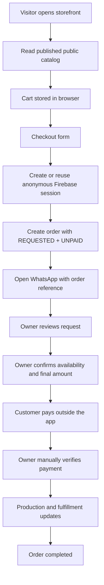

# System Overview

## Application model

KudapKita MVP is one responsive React web app with two explicitly separated surfaces:

- **Storefront:** public visitor/customer pages.
- **Owner Workspace:** protected operational pages.

The same codebase is served by Firebase Hosting. React Router controls navigation, while Firestore Security Rules enforce data access independently of the UI.

## Stack

| Layer | Technology | Responsibility |
|---|---|---|
| Language | TypeScript | Shared types and compile-time checks |
| UI | React | Components and state |
| Build/dev server | Vite | Development and static build |
| Styling | Tailwind CSS v4 | Responsive presentation |
| Routes | React Router | Public and private route trees |
| Authentication | Firebase Authentication | Owner email/password and guest anonymous session |
| Database | Cloud Firestore | Catalog, orders, payments, inventory and settings |
| Hosting | Firebase Hosting | Static SPA hosting |
| Version control | Git/GitHub | Source history and collaboration |

## Request flow

## Data trust boundaries

- Browser-provided product labels and displayed prices are not authoritative.
- Owner must recompute the final amount from the current internal product data before sending payment instructions.
- The initial order document is a customer request, not recognized revenue.
- Only owner action can change order/payment status.
- Firestore rules deny customers updating their order document after submission.

## Spark-compatible design

No Cloud Functions, Firebase Storage, scheduled jobs, or payment gateway are included. Business operations that need trusted server execution are handled manually by owner for MVP. If future needs require automatic stock reservation, trusted price calculation, scheduled expiry, upload verification, or payment webhooks, re-evaluate the billing plan and backend architecture first.
